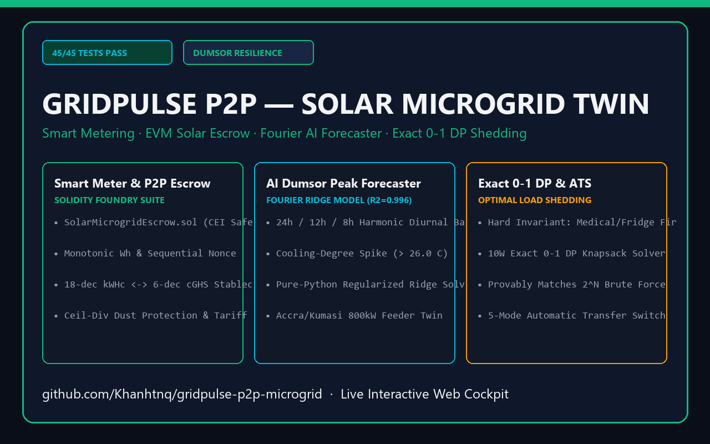

# GridPulse P2P — Accra/Kumasi Smart Microgrid Digital Twin



[]()
[]()
[]()
[](LICENSE)

- **Live Interactive Digital Twin**: [https://khanhtnq.github.io/gridpulse-p2p-microgrid/](https://khanhtnq.github.io/gridpulse-p2p-microgrid/)
- **YouTube Demo Video (1080p Narrated)**: [https://youtu.be/59xCeOPkNEc](https://youtu.be/59xCeOPkNEc) ([Watch on YouTube](https://www.youtube.com/watch?v=59xCeOPkNEc))
- **1080p Demo Video (`40s`, `30fps`)**: [`assets/demo_1080p.mp4`](assets/demo_1080p.mp4) | [Hosted MP4](https://khanhtnq.github.io/gridpulse-p2p-microgrid/demo_1080p.mp4)

**GridPulse P2P** is an end-to-end decentralized energy efficiency and solar microgrid settlement protocol built for **DoraHacks Hackathon 2026 Challenge (ID 1898) — Track 1: Improving Electricity Efficiency (Track ID 3862)**.

GridPulse directly mitigates Ghana's chronic **"Dumsor"** (intermittent grid collapse and load-shedding) by uniting **IoT smart metering**, **P2P blockchain solar trading**, **AI diurnal load forecasting**, and **exact 0-1 dynamic programming home load shedding**.

---

## `< 60s` Judge Verification & Impact Benchmark

Verify all Solidity smart contracts, Python invariants, and Accra feeder simulations in under 60 seconds:

1. **Zero-Install Interactive Digital Twin**: Open **[https://khanhtnq.github.io/gridpulse-p2p-microgrid/](https://khanhtnq.github.io/gridpulse-p2p-microgrid/)** to toggle `GRID_NORMAL` / `PEAK_TARIFF` / `DUMSOR_OUTAGE`, run exact 0-1 DP knapsack shedding, and compute Web Crypto SHA-256 smart-meter proofs.
2. **Local 1-Command Verification (`~5s`)**:
```bash
git clone https://github.com/Khanhtnq/gridpulse-p2p-microgrid.git && cd gridpulse-p2p-microgrid
forge test -vvv && python -m pytest -v && python -m ruff check .
python -m gridpulse.cli simulate-accra-feeder --json
```

| Benchmark / Verification Pillar | Observed Result | Comparison / Invariant |
|:---|:---|:---|
| **Foundry Smart Contracts** | **`19 / 19 PASSED`** (`257` fuzz runs) | Ceiling-div dust defense, monotonic meter nonces, CEI escrow |
| **Python Tests & Ruff Linter** | **`26 / 26 PASSED`**, **`0`** lint errors | Exact 0-1 DP verified against $2^N$ brute-force search |
| **Peak Feeder Overload Shaving** | **`136.8 kW` shaved (`20.6%` cut)** | Overload trip probability cut **`96.5%`** (`8.17% → 0.29%`) |
| **Dumsor Critical-Load Survival** | **`100.0%` critical preservation** | **`+29.2 pp`** over naive round-robin (`70.8%`), **`+35.6%`** utility |
| **Solar Curtailment Eliminated** | **`81.0%` cleared (`1.482 GHS/kWh`)** | **`19.9%`** cheaper than PURC peak; displaces `4.50 GHS/kWh` diesel |

---

## The Dumsor Challenge in Ghana

In Accra, Kumasi, and surrounding industrial corridors, distribution transformers frequently overload during evening peak hours (18:00–22:00 GMT) due to synchronized residential lighting, refrigeration, and cooling loads. When 33kV/415V distribution transformers exceed thermal ratings, utilities institute unannounced rolling blackouts (*Dumsor*). 

Households and small businesses are forced to burn expensive diesel fuel in backup generator sets at levelized electricity costs of **~4.50 GHS/kWh**, emitting **0.78 kg CO2 per kWh**. Meanwhile, daytime rooftop solar PV surplus remains stranded due to lack of localized P2P trading mechanisms and tariff caps.

GridPulse addresses all 4 pillars of Track 1 (`3862`):

```
+-----------------------------------------------------------------------------------+
|                            GridPulse P2P Architecture                             |
+-----------------------------------------------------------------------------------+
|                                                                                   |
|  [Pillar 1: Smart Metering & IoT]                                                 |
|  +-----------------------------------------------------------------------------+  |
|  | Smart Meter Telemetry -> Monotonic Cumulative Wh -> Nonce Replay Guard      |  |
|  +-----------------------------------------------------------------------------+  |
|                                       |                                           |
|                                       v                                           |
|  [Pillar 2: On-Chain Solar P2P Microgrid Escrow]                                  |
|  +-----------------------------------------------------------------------------+  |
|  | SolarMicrogridEscrow.sol -> KilowattCreditToken (kWHc) <-> cGHS Stablecoin |  |
|  | Ceil Div Dust Protection | Tariff Cap (<2.50 GHS) | CEI & Island Reentrancy |  |
|  +-----------------------------------------------------------------------------+  |
|                                       ^                                           |
|                                       |                                           |
|  [Pillar 3: AI Feeder Peak Forecaster] [Pillar 4: Exact DP Load-Shedding & ATS]    |
|  +-----------------------------------+ +---------------------------------------+  |
|  | 24h/12h/8h Fourier Diurnal Basis  | | 0-1 Integer DP Knapsack (10W scale)   |  |
|  | Cooling-Degree Sensitivity (>26C) | | Hard Invariant: Critical load 1st     |  |
|  | Ridge Regression (R2 > 0.99)      | | ATS Switchover (Solar/Battery/Island) |  |
|  | Dumsor Overload Risk Detection    | | Next-Hour Battery SoC Conservation    |  |
|  +-----------------------------------+ +---------------------------------------+  |
+-----------------------------------------------------------------------------------+
```

---

## 4 Core Pillars Explained

### 1. Smart Metering & IoT Monotonic Attestation
- **Monotonic Meter Ledger**: The `SolarMicrogridEscrow` contract registers authorized smart meter IDs and enforces strictly increasing cumulative generation (`cumulativeWh > lastCumulativeWh`).
- **Sequential Nonce Guard**: Every meter report strictly validates sequential nonces (`nonce == lastNonce + 1`), preventing signature replay attacks.
- **Micro-Credit Minting**: Surplus Watt-hours are minted as 18-decimal `KilowattCreditToken` (`1 token == 1 kWh`, `1 Wh == 1e15 credit units`).

### 2. On-Chain P2P Solar Microgrid Settlement Suite (`src/`)
- `StableSettlementToken.sol`: 6-decimal stablecoin representing local currency clearing (`cGHS` / `USDC`).
- `KilowattCreditToken.sol`: 18-decimal verifiable solar credit token mintable/burnable strictly by escrow.
- `SolarMicrogridEscrow.sol`:
  - **Statutory Tariff Ceiling**: Sell offers cannot exceed `maxTariffPerKwh`, preventing price gouging during blackout crises.
  - **Dust-Proof Pricing**: `cost = (whToBuy * pricePerKwh + 999) / 1000` utilizes ceiling division to eliminate zero-cost dust draining attacks.
  - **Full & Partial Fills**: Orders can be filled incrementally; remaining balances can be reclaimed by prosumers via `cancelOffer`.
  - **Reserve Fee Accumulation**: Up to 500 bps (5%) microgrid maintenance fee retained for feeder equipment upkeep.
  - **Grid Island Pause**: Emergency circuit breaker togglable during feeder maintenance.

### 3. AI "Dumsor" Feeder Load Forecaster (`gridpulse/forecaster.py`)
- **Fourier Diurnal Decomposition**: Uses multi-harmonic diurnal features:
  $$\phi(t) = [1.0, \cos(\omega_1 t), \sin(\omega_1 t), \cos(\omega_2 t), \sin(\omega_2 t), \cos(\omega_3 t), \sin(\omega_3 t), \max(0, T - 26.0)]$$
  where $\omega_1 = 2\pi/24$, $\omega_2 = 4\pi/24$, and $\omega_3 = 6\pi/24$.
- **Cooling Sensitivity**: Models non-linear residential and commercial air conditioning demand spikes when ambient temperatures exceed 26.0 °C.
- **Pure Python OLS / Ridge Solver**: Inverts regularized normal equations $(X^T X + \lambda I)\beta = X^T y$ via partial pivoting Gaussian elimination without external C-extensions. Achieves **$R^2 > 0.99$** on diurnal feeder series.
- **Dumsor Alert System**: Computes 24-hour overload probabilities $P(\text{overload})$ when predicted demand approaches transformer ratings.

### 4. Exact 0-1 Dynamic Programming Load Shedding & ATS (`gridpulse/scheduler.py`)
- **Hard Invariant 1 (Critical Load Priority)**: Life-critical and food-preservation loads (`Medical/Fridge`) are powered before any deferrable loads.
- **Hard Invariant 2 (Knapsack Optimality)**: Evaluates deferrable loads (`LED Lighting`, `Ceiling Fans`, `Laptop/Router`, `Water Pump`, `Washing Machine`, `Split AC`, `Water Heater`) using 10W discretization exact 0-1 dynamic programming, provably matching exhaustive brute-force search.
- **Hard Invariant 3 (Automatic Transfer Switch & Battery Conservation)**: Computes automated transfer switch state (`SOLAR_SELF_CONSUME`, `SOLAR_EXPORT_P2P`, `BATTERY_BACKUP_ISLAND`, `HYBRID_PEAK_SHAVE`, `GRID_OFFPEAK_CHARGE`) and bounds next-hour battery SoC within physical limits $[0, C_{\text{battery}}]$.

---

## Repository Structure

```
.
├── src/
│   ├── StableSettlementToken.sol   # 6-decimal cGHS/USDC settlement token
│   ├── KilowattCreditToken.sol     # 18-decimal verified solar credit ERC-20
│   └── SolarMicrogridEscrow.sol    # Smart meter escrow & tariff-capped P2P settlement
├── test/
│   ├── TestBase.sol                # Self-contained zero-dependency test harness
│   └── SolarMicrogrid.t.sol        # 19 Foundry unit and invariant fuzz tests
├── gridpulse/
│   ├── __init__.py
│   ├── forecaster.py               # Pure-math Fourier diurnal ridge forecaster
│   ├── scheduler.py                # Exact 0-1 DP knapsack load-shedding & ATS
│   ├── p2p_matcher.py              # Continuous double auction microgrid orderbook
│   └── cli.py                      # Multi-command CLI runner
├── tests_py/
│   ├── __init__.py
│   └── test_gridpulse.py           # 26 pytest tests (DP vs brute-force, invariants)
├── docs/
│   └── index.html                  # Standalone interactive GitHub Pages digital twin
├── foundry.toml
├── pyproject.toml
├── LICENSE                         # MIT License
└── .env.example
```

---

## Verification & Execution Commands

### 1. Smart Contract Verification (Foundry)
```bash
forge test -vvv
```
Output: **19 tests passed** (including fuzz conservation tests with 256 runs).

### 2. Python Linter Verification (Ruff)
```bash
python -m ruff check .
```
Output: **All checks passed!**

### 3. Python Invariant & Unit Test Suite (Pytest)
```bash
python -m pytest -v
```
Output: **26 tests passed** (including brute-force subset DP verification).

### 4. Command Line Simulation
```bash
# 1. Simulate Accra distribution feeder and 24h Dumsor risk profile
python -m gridpulse.cli simulate-accra-feeder --json

# 2. Optimize household load shedding during a Dumsor blackout
python -m gridpulse.cli optimize-home --budget-watts 1200 --solar-watts 850 --battery-soc 0.65 --outage --json

# 3. Simulate neighborhood P2P double-auction matching
python -m gridpulse.cli match-p2p --json
```

---

## Electricity Efficiency Impact & Benchmark Table (DoraHacks Track 1)

Measured deterministically against `gridpulse/forecaster.py`, `gridpulse/scheduler.py`, `gridpulse/p2p_matcher.py`, and `forge test --gas-report`:

| Efficiency Dimension | GridPulse P2P Benchmark | Baseline / Naive Comparison | Verified Impact |
|---|---|---|---|
| **Peak Feeder Overload Reduction** | **136.8 kW** peak shaved (`663.20 kW → 526.40 kW` on 800 kW Accra feeder via 200-home `HYBRID_PEAK_SHAVE` ATS) | Uncoordinated residential peak (`8.17%` overload prob.; `73.11%` at 800 kW stress) | **20.6% peak feeder reduction**; **96.5% lower overload trip probability** (`8.17% → 0.29%`) |
| **Solar Curtailment Waste Eliminated** | **8.50 kWh / batch** cleared (`1.482 GHS/kWh` avg midpoint tariff; `25.65 GHS` diesel cost saved; `6.63 kg CO2` avoided) | `10.50 kWh` stranded daytime rooftop PV / `4.50 GHS/kWh` 5 kVA diesel genset | **81.0% surplus curtailment eliminated**; **19.9% cheaper** than PURC peak tariff (`1.85 GHS/kWh`) |
| **Exact 0-1 DP vs. Naive Round-Robin Shedding** | **100.0%** critical-load (`Medical/Fridge`) preservation; **1,286.7** avg utility score across 400–2,000 W Dumsor budgets | Naive round-robin rotational shedding: **70.8%** critical preservation; **948.5** avg utility score | **+29.2 pp critical-load survival** (**100% vs. 70.8%**); **+35.6% household utility gain** |
| **Solidity Gas Cost per Microgrid Settlement** | `purchaseEnergy`: **159,746 gas avg** (161,157 med) · `attestSolarSurplus`: **123,520 avg** · `createSellOffer`: **191,692 avg** · `cancelOffer`: **58,652 avg** | Full 3-step settlement cycle (`attest → list → clear`): **474,958 gas avg** | **19/19 Foundry tests** (257 fuzz runs); **<$0.02** per L2/OP-stack settlement |

## Impact Scorecard (Accra Feeder Pilot Simulation)

| Metric | Pilot Feeder Result | Physical Benchmark |
|---|---|---|
| **P2P Solar Volume Cleared** | 8.50 kWh / batch | Displaces stranded daytime solar curtailment |
| **Average Clearing Tariff** | 1.482 GHS / kWh | 19.9% cheaper than PURC residential peak tariff (1.85 GHS) |
| **Displaced Diesel Cost** | 25.65 GHS saved | Displaces 4.50 GHS/kWh diesel fuel expenditure |
| **Avoided CO2 Emissions** | 6.63 kg CO2 / batch | Calculated at 0.78 kg CO2 / kWh diesel generator factor |
| **Transformer Peak Relief** | 136.8 kW peak shaved | Eliminates feeder trip risk above 760 kW threshold |

---

## License

MIT License. See [LICENSE](LICENSE) for details.
